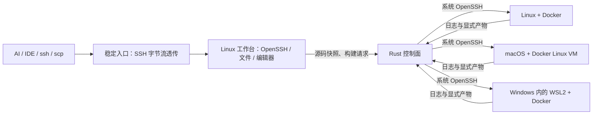

# SSHPool

**一个稳定的 Linux / SSH 工作台，多台可替换的构建节点。**

**目标差距：当前产品不满足“一个 Linux/数据库实例使用多台机器合计资源”的完整 SSI 要求。** 资源池与有状态恢复仍未交付。最新 GiantVM 调研、实际 KVM/ISA 阻塞和容量边界见 [严格 SSI 可行性](docs/ssi-feasibility.md)；不要把任务调度器的验收数量当作 SSI 完成度。

**SSI 实验进展（2026-11-06）：** 已在同一 ESXi 的两个隔离 x86_64 节点上启动一个 Ubuntu 客体，完成同进程跨节点内存测试、SSH、1 MiB SFTP 和正常关机。PF6 修复了 pvclock 绕过 DSM 写权限导致远端读到旧版本的问题，两次真实接口探针通过；见 [pvclock 修复与证据](docs/ssi-pvclock.md)。**PF9 本轮四个定时器、内存和文件传输回归通过，但仍有 watchdog 和 DSM 关闭错误，完整 SSI 工作区未通过验收。** 较早实验的 RTC 读取失败和约 6.97 秒定时器延迟保留为历史故障证据，尚无长期稳定性结论；跨物理机、超单机内存、持久磁盘、Docker、数据库和故障恢复均未验收。此前 [设备内存](docs/ssi-device-memory.md)、[时钟](docs/ssi-clock.md) 和 [SSH 工作区](docs/ssi-workspace.md) 记录保留用于对照。

**设备顺序实验：** 受控延迟下，原远端 MMIO 路径的 256 次检查出现 23 次旧值读取；增加设备执行后的完成确认，同一探针全部通过。仍是实验候选，启动/清理、时钟、持久磁盘及数据库尚未完成，见 [设备完成边界与失败记录](docs/ssi-device-order.md)。

**启动回收实验：** PF8 将本地 DSM 监听失败同步返回 QEMU；两节点的端口冲突、同 VM 重试、各 64 次启停和两种半帧关闭顺序通过。全局协调启动、在途请求排空与故障接管仍未完成，见 [启动回收证据与限制](docs/ssi-startup.md)。Ceph 尚未使用。

**关闭顺序实验：** PF9 在销毁 vCPU/MMU 前停止 DSM 线程。旧内核的真实跟踪暴露了相反顺序；新内核在两节点、两种关闭顺序的四组测试中通过，见 [内核跟踪与边界](docs/ssi-teardown.md)。正在处理的页面事务取消和正常关闭协议仍未完成。

SSHPool 面向只能配置一个远程主机的 AI 编程工具、Remote SSH IDE 和终端。工作台放在可靠的宿主上，源码与编辑会话留在工作台；明确加入的项目可以把构建交给资源合适的 SSH 节点。

当前是 **0.1 实验版本**：统一 SSH、整项构建调度和隔离执行已经实现。它不提供跨机器共享内存，不会让任意程序自动获得集群所有 CPU，也不会透明迁移正在运行的进程。普通命令在工作台执行；项目 opt-in 后，支持的构建包装器自动调度。详细需求与尚未实现的目标见 [FEATURE.md](FEATURE.md)。

**登录后的 `uname`、`top`、`free` 只显示工作台资源。** `sshpool status` 查看各节点快照；实际计算节点以任务的 `attempts[].node` 和远端容器为准。已验证 ARM64 工作台提交到独立 x86_64 Linux Worker 的计算、日志、产物和清理闭环；macOS Worker 只有资源探测证据，WSL2 尚未实机验证。当前不会把 sub2api 进程的内存压力自动转移到其他设备。证据和复现步骤见 [硬件执行验证](docs/validation.md#hardware-proof)。



图中 macOS / WSL2 表示适配方向，不能视为均已完成执行验收。

## 能力与边界

- **真正的 SSH 兼容面**：复用后端 OpenSSH，透传交互终端、SFTP/scp、rsync 和端口转发。后端故障时已有连接会断开，不伪造无损迁移。
- **简单节点登记**：复用系统 SSH 别名、密钥和跳板；不在 Worker 安装常驻 Agent，不分发控制面的私钥。
- **保守调度**：检查平台、内存、磁盘、负载、并发配额；先留出业务资源。无适合节点时明确失败，不在忙碌主机上硬启动。
- **隔离构建**：容器非 root、只读根文件系统、无宿主 bind mount、无 Docker socket、默认禁网、限制 CPU/内存/PID/日志/时间。工作区为有容量上限的 tmpfs，计入内存限制。
- **数据闭环**：明确选择项目，遵循 `.gitignore`，拒绝符号链接并排除常见凭据；只取声明的产物，导出到新目录，绝不覆盖源工程。
- **谨慎重试**：编译返回非零不会自动重试。基础设施失败只有在 `idempotent=true`、禁网、旧容器确认清理且仍有重试额度时才切换节点。SSH 断线不被视为任务已经停止。
- **持久记录**：任务、节点选择、尝试与结果写入控制面私有目录。重启后核对未完成任务并记录中断，不盲目重放。容器自身还有最长存活时间。

## 快速开始

需要 Rust 1.89+、系统 OpenSSH。Worker 需要 Python 3、可用的 Docker Linux 引擎，以及允许 `docker create/start/exec/inspect/rm` 的可信运维账号。用户提供的构建脚本只在受限容器内执行。默认容器隔离不是对不可信租户的完整安全边界；生产隔离建议用专用计算虚拟机和 rootless Docker。

```sh
cargo install --git https://github.com/zjarlin/sshpool --locked
sshpool init
sshpool node add linux-builder --ssh my-linux --reserve-memory-mib 8192
sshpool node add arm-builder --ssh my-mac --reserve-memory-mib 4096
sshpool doctor
sshpool node prepare linux-builder alpine:3.22
sshpool serve
```

配置位于 `~/.sshpool/config.toml`。节点地址、token、SSH 凭据与任务数据都不应提交到 Git。配置修改后重启控制面。`prepare` 是显式拉取镜像操作；普通构建不会自动拉镜像。`prepare` 同时把镜像加入该节点的允许清单；已安装的业务镜像也不会自动开放给任务。

稳定 Linux 工作台可以是已有 Linux 主机，或 Mac 上无宿主目录挂载的 Lima VM。把 `ssh_backend` 指向它的 SSH 端口，客户端只连接 `ssh_listen`。默认两者为 `127.0.0.1:2223` 和 `127.0.0.1:2222`。

Mac 的完整引导见 [部署文档](docs/deployment.md)，可使用仓库内的 `scripts/create-workspace.sh` 创建隔离的 Linux 工作台。

### 提交一个项目

```sh
cd my-project
sshpool project-init --image rust:1.93 --platform linux/amd64
```

编辑生成的 `sshpool.toml`，例如：

```toml
image = "rust:1.93"
platform = "linux/amd64"
command = ["cargo", "build", "--release"]
outputs = ["target/release/my-app"]
memory_mib = 4096
scratch_mib = 2048
cpus = 2.0
timeout_secs = 1200
pids = 256
network = true
retries = 0
idempotent = false
```

```sh
sshpool run
sshpool jobs
sshpool logs <job-id>
sshpool fetch <job-id>
sshpool cancel <job-id>
```

日志返回当前终端；产物由 `fetch` 解包到 `.sshpool/results/<job-id>/`。已存在的输出目录会被拒绝。私有依赖建议预先制作镜像；不要在构建参数、项目文件或镜像里放生产凭据。

镜像中的编译器负责执行构建。平台必须明确匹配：`linux/amd64` 产物不能当作 `linux/arm64` 产物。Mac Worker 贡献的是 Docker Linux VM，当前不执行原生 Xcode/macOS 构建。Windows Worker 的 SSH 必须进入 WSL2，而不是 PowerShell。

### 保留常用构建命令

```sh
sshpool install-shims
export PATH="$HOME/.sshpool/bin:$PATH"
cargo build --release
```

包装器支持 `cargo build/test/check/clippy`、`gradle`、`make`，只在有 `sshpool.toml` 的项目根目录中分发；版本查询、Cargo 元数据等仍走本地工具。它不会劫持任意 shell 命令。`./gradlew` 不经过 PATH，使用 `sshpool run -- ./gradlew build`。Node.js、Python、其他构建工具也可以用 `run -- ...`，只需相应容器镜像。

### Linux 工作台连接 Mac 控制面

客户端二进制支持：

```sh
export SSHPOOL_ENDPOINT=http://host.lima.internal:8877
export SSHPOOL_TOKEN_FILE="$HOME/.sshpool/token"
```

仅把控制面 token 放到可信工作台，权限设为 `0600`。节点 SSH 私钥留在 Mac。默认 API 只监听宿主回环；跨不可信网络使用 SSH 转发或 HTTPS，不能把明文 HTTP 暴露到公网。

## 已知限制

- 使用整个任务分派；尚未集成 sccache/Icecream 的编译单元拆分或远程缓存。原型借鉴 Slurm 的资源预约、OpenSSH 的连接面和容器运行时的隔离机制，不依赖这些项目的源码。
- tmpfs 避免写满业务磁盘，但大型构建需要相应内存。不能把多个 Worker 的内存合并给一个任务。
- 资源探测是快照，业务负载仍可能突然增长。预留量需要按部署测量，容器和虚拟化引擎必须支持并实际执行 cgroup 限额。
- Docker Desktop 的内部磁盘与空闲内存不能仅由宿主指标完全判断。任务不会自动拉镜像，工作区不使用宿主磁盘；镜像维护仍由运维负责。
- 不自动同步已有工程或清理公司文件。任务记录与源码归档当前保留供诊断；应在控制面停机后按保留策略管理专用状态目录。
- 不保证入口 Mac 关机、休眠或重启时会话在线。稳定入口仍是一个故障域。
- 不提供 NAT 穿透；复用已有 SSH ProxyJump/ProxyCommand 或受控网络。没有新增路由、隧道或端口映射。

## 开发与验证

```sh
cargo fmt --check
cargo clippy --all-targets -- -D warnings
cargo test
```

从 `src/main.rs` 看 CLI，再看 `src/api.rs` 的任务接收，最后看 `src/runner.rs` 的容器生命周期。`src/scheduler.rs` 负责资源选择，`src/archive.rs` 负责文件边界。架构、验证范围与未来方向见 [docs/architecture.md](docs/architecture.md)。

MIT License.
