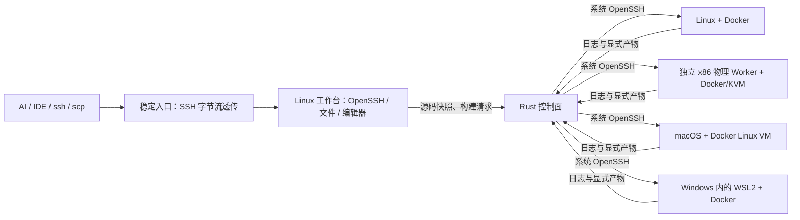

# SSHPool

**一个稳定的 Linux / SSH 工作台，多台可替换的构建节点。**

**目标差距：当前产品不满足“一个 Linux/数据库实例使用多台机器合计资源”的完整 SSI 要求。** 资源池与有状态恢复仍未交付。最新 GiantVM 调研、实际 KVM/ISA 阻塞和容量边界见 [严格 SSI 可行性](docs/ssi-feasibility.md)；不要把任务调度器的验收数量当作 SSI 完成度。

**跨物理机预检与真实卸载：** `sshpool ssi-preflight <SSH目标一> <SSH目标二>` 通过已有 SSH 查询真实 KVM 频率和接口，不安装软件或运行客体。独立物理候选与 ESXi 实验 VM 的原生 TSC 分别为 2,095,147 与 2,394,374 kHz，双方无硬件缩放；当前 SSI 运行时明确拒绝配对。该独立 x86 物理机已作为真实 Docker/Cargo Worker 接入，并从 ARM64 工作台完成一次离线编译、产物执行和清理；**这仍是任务调度，不是跨物理 SSI**。实测及无 RAID 存储边界见 [物理接入记录](docs/ssi-physical-storage.md) 和 [验证记录](docs/validation.md#physical-host-and-build-proof)。

**暂停恢复进展：** 为两端已分别暂停的实验客体增加代际检查、重新校时和两阶段恢复确认，并修复超时线程陷入 QEMU 退出回调锁的问题。有限七轮恢复与拒绝路径见 [时钟恢复、失败记录和范围](docs/ssi-clock-resume.md)。**单条全局暂停、重置后恢复、跨物理稳定性和完整 SSI 仍未完成**；反向 watchdog 与设备排空后的失败记录继续保留。

**复位路由进展：** 修复副节点收到 RESET 后退出接收循环、丢失后续关闭通知的问题。真实 EIO、反向 ENOSPC、三次连续复位和主 QEMU 突然退出的候选对照均完成预期退出，旧版 40 秒超时记录保留。只验证暂停后的复位再关闭或失败停止；复位后恢复、DSM 干净关闭和完整 SSI 仍未通过。见 [复位路由、原始事件与边界](docs/ssi-reset-router.md)。

**真实设备页引用进展：** 双节点原生 KVM 查询复现并修复 virtio-blk 销毁后遗留两个读引用和一个写引用的问题；EIO、交换实验 VM 角色的 ENOSPC 和正常写入对照通过，同时修复本地暂停等待远端占位线程的阻塞。该轮发现的复位后退出问题已继续修复，有限时钟恢复进展见上文。两节点仍在同一物理 ESXi，Ceph、跨物理容量和数据库尚未接入。见 [页引用、暂停、失败与回归](docs/ssi-virtio-dsm-pins.md)。

**真实磁盘请求前期结果：** 修复客体写入失败后“最终刷盘成功就退出零”的遗漏。两台原版内核实验 VM 的 20 次单节点对照中，候选保留 EIO/ENOSPC，正常写入和成功重试仍退出零。复位能清除队列计数但不能恢复未写入数据；该轮没有观察 DSM 页引用，后续实验见上文。见 [真实 virtio 请求、关闭错误与边界](docs/ssi-virtio-pending.md)。

**关闭刷盘最新进展：** 修复 `vm_shutdown()` 已返回刷盘错误却继续正常关闭的问题。8 组单节点和 5 组双节点真实 blkdebug 对照通过：旧版 EIO/ENOSPC 仍退出零，候选令故障两端退出一，无故障仍退出零。完整客体 SSH、共享内存和 SFTP 通过，双节点定时器最大 104.90 ms；**DSM 关闭仍报错，完整 SSI 未通过**。这不证明掉电持久性或客体 DMA 已验收，见 [刷盘错误、证据和待完成设备请求](docs/ssi-shutdown-flush.md)。

**QEMU 映射进展：** 修复真实 KVM 固定失败仍返回可用内存、解除失败仍继续返回的问题。两台实验 VM 的 4 组旧版对照与 10 组候选测试通过；失败路径保留 stderr、平衡引用并失败停止。普通候选的双节点 SSH、共享内存和 SFTP 通过，定时器最大 96.47 ms；**两端 DSM 关闭仍报错，完整 SSI 未通过**。新增物理机只完成 SSH/KVM 预检，Ceph、持久磁盘和跨机接管仍未交付。见 [映射失败修复与证据](docs/ssi-qemu-map-failure.md)、[跨物理机与无 RAID 存储边界](docs/ssi-physical-storage.md)。

**PF24 解除进展：** 新固定调用等待远端页面时，旧引用可以先释放，避免已复现的反向依赖；暂存读写引用、失败回滚、并发重复解除和零引用时的槽保护通过两台实验 VM 的 12 组探针。保留 2 组 PF23 阻塞对照及 1 次建连失败。完整双节点 SSH、共享内存和 SFTP 完成，三轮定时器最大 123.73 ms，通过原 250 ms 门槛；**两端 DSM 关闭仍报错，完整 SSI 未通过**。Ceph、Docker、数据库与跨物理机接管仍未交付，见 [解除进展、失败记录与剩余范围](docs/ssi-pin-release.md)。

**PF23 历史进展：** 修复设备固定页面仍被持有时错误封闭 ioctl 入口的问题；重复或错误类型的解除不再减计数，部分固定失败只回滚本次新增引用。两台实验 VM 的 8 组候选探针通过，保留 2 组 PF22 失败对照。完整双节点操作完成，但定时器最大 264.93 ms 超过原 250 ms 门槛，DSM 关闭仍报错，**完整 SSI 未通过**。Ceph、Docker、数据库和跨物理机接管仍未交付，见 [固定页面修复、实测与剩余范围](docs/ssi-pin-lifecycle.md)。

**PF22 事务进展：** DSM 出站事务和缓存响应持续计数到真正消费或故障回收；两台专用实验 VM 的六类探针通过。还复现并修复了 PF21 在 65,535 个活跃编号后无限重试的问题，保留失败记录。该轮双节点 SSH、内存、文件传输和三轮时钟通过，但 **DSM 关闭错误仍阻止完整 SSI 验收**，历史 RTC/时钟失败也没有被本次通过覆盖。Ceph、Docker、数据库与跨物理机接管仍未交付，见 [实现、证据和剩余范围](docs/ssi-exchange-accounting.md)。

**SSI 实验进展（2026-11-06）：** 已在同一 ESXi 的两个隔离 x86_64 节点上启动一个 Ubuntu 客体，完成同进程跨节点内存测试、SSH、1 MiB SFTP，并观察到客体关机后的 QEMU 退出；内核 DSM 正常关闭尚未通过。PF6 修复了 pvclock 绕过 DSM 写权限导致远端读到旧版本的问题，两次真实接口探针通过；见 [pvclock 修复与证据](docs/ssi-pvclock.md)。**PF11 历史内存和文件传输回归通过，但一个 20 ms 定时器耗时约 2.354 秒，超过 250 ms 门槛，仍有 watchdog 和 DSM 关闭错误，完整 SSI 工作区未通过验收。** PF10 的约 537 ms、较早实验的 RTC 读取失败和约 6.97 秒延迟均保留为历史证据，不能由单次差异推断本轮补丁的性能因果；跨物理机、超单机内存、持久磁盘、Docker、数据库和故障恢复均未验收。此前 [设备内存](docs/ssi-device-memory.md)、[时钟](docs/ssi-clock.md) 和 [SSH 工作区](docs/ssi-workspace.md) 记录保留用于对照。

**设备顺序实验：** 受控延迟下，原远端 MMIO 路径的 256 次检查出现 23 次旧值读取；增加设备执行后的完成确认，同一探针全部通过。仍是实验候选，启动/清理、时钟、持久磁盘及数据库尚未完成，见 [设备完成边界与失败记录](docs/ssi-device-order.md)。

**启动回收实验：** PF8 将本地 DSM 监听失败同步返回 QEMU；两节点的端口冲突、同 VM 重试、各 64 次启停和两种半帧关闭顺序通过。全局协调启动、在途请求排空与故障接管仍未完成，见 [启动回收证据与限制](docs/ssi-startup.md)。Ceph 尚未使用。

**关闭顺序与请求取消：** PF9 在销毁 vCPU/MMU 前停止 DSM 线程，见 [关闭顺序证据](docs/ssi-teardown.md)。PF10 修复缺失内存槽时无法取消的完整读页循环，见 [请求取消证据](docs/ssi-request-cancel.md)。PF11 为接收提供缓冲区容量并统一异常回收，两节点各十五类异常请求和同页锁取消通过实机事件核验，见 [请求安全证据](docs/ssi-request-safety.md)。事务缓存、超长失效响应、内部不变量异常和正常关闭协议仍未全部验收。

**延迟定位：** 单节点/双节点页面探针通过内容、并发写入与逐线程 ioctl 计时核验。此前捕获计时数据页上的具体缺页指令，以及一个 TCP 已确认后仍等待约两秒才响应的请求；详见 [定位与验收边界](docs/ssi-latency.md)。

**调度与资源预检：** 实测发现两台实验 VM 各有 2000 MHz CPU 总限额，并有明确 ESXi 限速计数；已仅在实验 VM 取消该限制。新增只读资源预检、调度等待分解和分块跟踪导出，见 [调度实验](docs/ssi-scheduling.md)。取消限额后的无跟踪测试有一次十二个定时器最大 86.6 ms，但仍有 watchdog 与关闭错误，不能据此宣布完整工作区或性能聚合通过。

**PF14 自旋实验：** 在没有 PLE 的实验宿主上，可显式强制 DSM 客体的 PAUSE 指令返回 KVM。已捕获真实退出并验证四个客体 vCPU 的用户态进度；开关默认关闭，完整 KVM／中断记录和同内核开关对照见 [实验结果](docs/ssi-vcpu-residency.md)。仍保留一次无跟踪 SFTP 建连超时和其余工作区失败，不能据此部署业务容器或数据库。

**PF15 宿主定时器：** KVM 返回时补上已有的延期重装处理。两侧完整跟踪的重装拖延从约 90–115 ms 降到最多 14 μs；两次三轮无跟踪时钟测试通过原 250 ms 门槛。RTC、watchdog 和关闭错误仍阻止完整 SSI 验收，Ceph、Docker 与数据库尚未接入；见 [结果、失败与原始记录边界](docs/ssi-host-timers.md)。

**RTC 路由候选：** 分布式 QEMU 禁用本地合并 PIO 注册后，两次双节点 RTC 探针各 32 次读取通过独立时间窗口核验，普通单节点保留原注册行为。首次工作区回归完成 SSH、内存和 SFTP，三轮定时器最大 66.6 ms；第二次启动却触发 DSM 页副本集合告警并失去响应，需要强制清理。**完整 SSI 仍失败，Ceph 和业务数据仍未接入。** 补丁、初步探针误判和失败现场见 [RTC 与剩余一致性问题](docs/ssi-rtc.md)。

**PF16 页副本集合：** 真实 KVM 单页实验复现了固定页面重试时提前清空副本集合的问题；候选保留尚未交出的副本集合，两节点对照通过。两次双节点工作区均完成 SSH、内存和 SFTP，三轮时钟上限保持 250 ms；正常关闭仍报 DSM 接收错误，完整 SSI 和业务存储仍未验收，见 [原因、对照与剩余范围](docs/ssi-copyset-retry.md)。

**PF17 故障传播：** 非法请求或断连现在会使实验 VM 失效，唤醒已建立连接中的等待者，并让 KVM 管理接口返回错误。真实双节点注入进一步暴露并修复 QEMU 错误转储的递归崩溃：新候选两端返回失败码 1，旧版段错误记录完整保留。这实现故障停止，正常关闭仍有连接重置，自动接管、Ceph 和业务数据恢复尚未实现，见 [故障传播实验](docs/ssi-failure-propagation.md)。

**QEMU 关闭屏障：** 协议三候选在停止 vCPU 和本地排空后核对双向确认，两个真实双节点关机对照通过该屏障。内核 DSM 仍报连接重置，完整关闭与持久化未验收，见 [路由排空与剩余关闭工作](docs/ssi-router-drain.md)。

**PF18/PF19 内核入站屏障：** 新增单条 DSM 入站流的排空确认，等待早先页面请求完成响应并释放页锁与 SRCU；七个并发请求和页锁竞争均有真实 KVM 证据，PF19 进一步在释放接收锁前锁存坏帧故障。PF19 双节点回归完成操作但仍出现启动 watchdog 告警，完整工作区未通过。全 VM 外部入口、反向请求与最终关闭尚未协调，Ceph、Docker、数据库和接管仍未交付，见 [内核入站排空实验](docs/ssi-kernel-drain.md)。

SSHPool 面向只能配置一个远程主机的 AI 编程工具、Remote SSH IDE 和终端。工作台放在可靠的宿主上，源码与编辑会话留在工作台；明确加入的项目可以把构建交给资源合适的 SSH 节点。

当前是 **0.1 实验版本**：统一 SSH、整项构建调度和隔离执行已经实现。它不提供跨机器共享内存，不会让任意程序自动获得集群所有 CPU，也不会透明迁移正在运行的进程。普通命令在工作台执行；项目 opt-in 后，支持的构建包装器自动调度。详细需求与尚未实现的目标见 [FEATURE.md](FEATURE.md)。

**登录后的 `uname`、`top`、`free` 只显示工作台资源。** `sshpool status` 查看各节点快照；实际计算节点以任务的 `attempts[].node` 和远端容器为准。已验证 ARM64 工作台提交到独立 x86_64 Linux Worker 的计算、日志、产物和清理闭环；macOS Worker 只有资源探测证据，WSL2 尚未实机验证。当前不会把 sub2api 进程的内存压力自动转移到其他设备。证据和复现步骤见 [硬件执行验证](docs/validation.md#hardware-proof)。



图中 macOS / WSL2 表示适配方向，不能视为均已完成执行验收；独立 x86 Worker 已完成任务级构建卸载，但尚未与入口组成同一个 SSI 客体。

## 能力与边界

- **真正的 SSH 兼容面**：复用后端 OpenSSH，透传交互终端、SFTP/scp、rsync 和端口转发。后端故障时已有连接会断开，不伪造无损迁移。
- **简单节点登记**：复用系统 SSH 别名、密钥和跳板；不在 Worker 安装常驻 Agent，不分发控制面的私钥。
- **保守调度**：检查平台、内存、磁盘、负载、并发配额；先留出业务资源。无适合节点时默认明确失败，不在忙碌主机上硬启动；显式配置后可以有限期等待。
- **隔离构建**：容器非 root、只读根文件系统、无宿主 bind mount、无 Docker socket、默认禁网、限制 CPU/内存/PID/日志/时间。工作区为有容量上限的 tmpfs（计入内存限制），允许执行编译产物而 `/tmp` 禁止执行。创建后会按真实 runtime 配置复核，不符合就不启动 —— Docker 会自行改写参数（例如给 tmpfs 默认加 `noexec`），只信任命令行声明是不够的。
- **数据闭环**：明确选择项目，遵循 `.gitignore`，拒绝符号链接并排除常见凭据；源码快照稳定排序并记录 SHA-256，控制面拒绝传输中摘要不匹配的归档。只取声明的产物，导出到新目录，绝不覆盖源工程。
- **谨慎重试**：编译返回非零不会自动重试。基础设施失败只有在 `idempotent=true`、禁网、旧容器确认清理且仍有重试额度时才切换节点。SSH 断线不被视为任务已经停止：容器 PID 1 自带 `sleep 超时 + 180s` 租约，`sshpool node reconcile` 凭远端状态或该租约在线解除隔离，容器仍在运行则继续拒绝。重跑只换机器，已执行过的节点不会再次接收同一任务。
- **持久记录**：配置两台独立物理副本并使用 quorum 2 时，已确认的任务状态、源码快照、日志、事件和声明产物可由任一存活远端恢复。正在运行的进程、内存和未检查点日志不会迁移；控制器仍需人工重建。任务状态容灾不等于 PostgreSQL/Redis 高可用，完整边界见 [故障与恢复](docs/failure-modes.md)。

## 快速开始

需要 Rust 1.89+、系统 OpenSSH。Worker 需要 Python 3、可用的 Docker Linux 引擎，以及允许 `docker create/start/exec/inspect/rm` 的可信运维账号。用户提供的构建脚本只在受限容器内执行。默认容器隔离不是对不可信租户的完整安全边界；生产隔离建议用专用计算虚拟机和 rootless Docker。

```sh
cargo install --git https://github.com/zjarlin/sshpool --locked
sshpool init
sshpool node add linux-builder --ssh my-linux --reserve-memory-mib 8192
sshpool node add arm-builder --ssh my-mac --reserve-memory-mib 4096
sshpool doctor
sshpool node prepare linux-builder alpine:3.22
sshpool serve
```

配置位于 `~/.sshpool/config.toml`。节点地址、token、SSH 凭据与任务数据都不应提交到 Git。新增节点或镜像后重启控制面；已有节点的 `node enable` / `node disable` 可在控制面运行时生效，仍有活动任务的节点不能被禁用。`prepare` 是显式拉取镜像操作；普通构建不会自动拉镜像。`prepare` 同时把镜像加入该节点的允许清单；已安装的业务镜像也不会自动开放给任务。

稳定 Linux 工作台可以是已有 Linux 主机，或 Mac 上无宿主目录挂载的 Lima VM。把 `ssh_backend` 指向它的 SSH 端口，客户端只连接 `ssh_listen`。默认两者为 `127.0.0.1:2223` 和 `127.0.0.1:2222`。

Mac 的完整引导见 [部署文档](docs/deployment.md)，可使用仓库内的 `scripts/create-workspace.sh` 创建隔离的 Linux 工作台。

### 提交一个项目

```sh
cd my-project
sshpool project-init --image rust:1.93 --platform linux/amd64
```

编辑生成的 `sshpool.toml`，例如：

```toml
image = "rust:1.93"
platform = "linux/amd64"
command = ["cargo", "build", "--release"]
outputs = ["target/release/my-app"]
memory_mib = 4096
scratch_mib = 2048
cpus = 2.0
timeout_secs = 1200
pids = 256
network = true
retries = 0
idempotent = false
queue_timeout_secs = 900
queue_priority = 0
```

`queue_timeout_secs` 的范围是零到 604800 秒。零是默认值，表示没有合适 Worker 时立即失败；非零会把源码保留在控制面本地，任务保持 `queued`，直到获得节点、取消或绝对期限到达。非零时可用 `queue_priority=-1000..1000` 调整有限队列顺序，数字越大越先尝试。重启不会延长原期限。配置状态副本后，只有达到 quorum 的状态才算跨主机持久提交；入口进程本身仍不会自动在多台机器间漂移。

```sh
sshpool run
sshpool jobs                      # 等价于 jobs list：从运行中的控制面列任务
sshpool jobs inspect              # 离线核对任务目录、摘要与版本预留
sshpool jobs prune --older-than-days 30 --keep-last 10          # 只打印计划
sshpool jobs prune --older-than-days 30 --keep-last 10 --apply  # 归档并移出 jobs/
sshpool logs <job-id>
sshpool fetch <job-id>
sshpool cancel <job-id>
```

`cancel` 会让远端真正停下：控制面按任务标签确认容器身份后发送 `docker stop`，再复核状态。只断开 SSH 连接不算停止 —— 实测断开后容器仍然在跑。停止未获确认时任务记为 `interrupted` 并隔离该 Worker，而不是报成 `cancelled`。

日志返回当前终端；产物由 `fetch` 解包到 `.sshpool/results/<job-id>/`。已存在的输出目录会被拒绝。私有依赖建议预先制作镜像；不要在构建参数、项目文件或镜像里放生产凭据。

镜像中的编译器负责执行构建。平台必须明确匹配：`linux/amd64` 产物不能当作 `linux/arm64` 产物。Mac Worker 贡献的是 Docker Linux VM，当前不执行原生 Xcode/macOS 构建。Windows Worker 的 SSH 必须进入 WSL2，而不是 PowerShell。

### 保留常用构建命令

```sh
sshpool install-shims
export PATH="$HOME/.sshpool/bin:$PATH"
cargo build --release
```

包装器支持 `cargo build/test/check/clippy`、`gradle`、`make`，只在有 `sshpool.toml` 的项目根目录中分发；版本查询、Cargo 元数据等仍走本地工具。它不会劫持任意 shell 命令。`./gradlew` 不经过 PATH，使用 `sshpool run -- ./gradlew build`。Node.js、Python、其他构建工具也可以用 `run -- ...`，只需相应容器镜像。

### Linux 工作台连接 Mac 控制面

客户端二进制支持：

```sh
export SSHPOOL_ENDPOINT=http://host.lima.internal:8877
export SSHPOOL_TOKEN_FILE="$HOME/.sshpool/token"
```

仅把控制面 token 放到可信工作台，权限设为 `0600`。节点 SSH 私钥留在 Mac。默认 API 只监听宿主回环；跨不可信网络使用 SSH 转发或 HTTPS，不能把明文 HTTP 暴露到公网。

### 控制面 HTTPS 与短期凭据

默认配置不启用 TLS，行为与之前一致。要跨不可信网络直连，在 `config.toml` 同时给出证书链与私钥（绝对路径，私钥必须 `0600`）：

```toml
tls_cert = "/etc/sshpool/fullchain.pem"
tls_key = "/etc/sshpool/privkey.pem"
```

只配其中一个、用相对路径、或私钥对组/其他可读都会让 `serve` 在绑定端口前失败。启用后同一个 `serve` 用 rustls 终止 TLS，ALPN 为 `h2` 和 `http/1.1`。客户端用自己的 CA 时显式指定：

```sh
export SSHPOOL_ENDPOINT=https://controller.example:8877
export SSHPOOL_CA_FILE=/etc/sshpool/ca.pem      # 或每次传 --ca-file
```

不提供跳过证书校验的开关；客户端只接受系统信任链或显式给的 CA。`--ca-file` 与 `http://` 端点组合会被直接拒绝，因为这一定是误配置。

多用户或多工作台可以签发短期凭据，不必分发根 token：

```sh
sshpool credential issue --subject workbench --ttl-hours 12                # 默认只读
sshpool credential issue --subject builder --ttl-hours 12 \
  --scope submit --scope cancel                                            # 可重复给权限
sshpool credential list
sshpool credential revoke <id>
sshpool credential prune --apply                                # 只清理已过期且已撤销的记录
```

明文 token 只在 `issue` 时打印一次，磁盘上只保存 SHA-256 摘要；有效期上限 90 天，到期是半开区间，撤销对之后发起的请求立即生效（已通过鉴权的进行中请求不会被中断）且可重复执行。根 token 仍然可用，并且是坏掉的 `credentials.json` 之外唯一的入口 —— 凭据库损坏时动态凭据一律 401，但根 token 不会因此被锁在门外。

权限是显式授予的四项白名单，签发时不写 `--scope` 只拿到 `read`：

| 权限 | 允许的路由 |
| --- | --- |
| `read` | `GET /v1/status`、`/v1/jobs`、任务详情、日志、事件、产物（任何凭据都有；没有它整份凭据库拒绝加载） |
| `submit` | `POST /v1/jobs` 提交任务（会占用 Worker） |
| `cancel` | `POST /v1/jobs/{id}/cancel` 请求停止任务 |
| `admin` | 节点启用/禁用、在线核对隔离、查询 `/v1/access` 访问审计；也是唯一能越过任务属主边界的凭据 |

缺权限返回 **403** 而不是 401（身份成立、权限不够），响应体只写缺哪一项：``credential lacks the `admin` scope``；审计里 401 与 403 一律记 `decision=denied`，`status` 保留具体状态码。旧版本签发、没有 `scopes` 字段的记录按最小权限降级为只读 —— 这是权限收紧，不给「缺字段等于全部权限」的兼容。根 token 不受分级影响，仍是运维用的全权凭据。

动作权限之外还有**主体范围**：任务的所有者由服务端在提交时按鉴权结果写入 `owner`（客户端给什么都无效），`read` 只看得到自己的任务，`cancel` 只取消得了自己的任务。别人的任务 `GET /v1/jobs` 里不出现，按 id 访问一律 **403**（`credential does not own this job`，不回 404，也不回显属主名），被拒的取消不会改动任务。归属按主体名而不是凭据 id 计算，所以轮换 token 后仍看得到自己昨天提交的任务；`root` 是保留主体名，不能被签成凭据。旧任务没有 `owner` 字段＝归属未知，按最严处理：只有根 token 和带 `admin` 的运维凭据能看。

### 访问审计

每个请求都留一行 JSON 到 `home/access.jsonl`（`0600`）：主体、身份来源（`root`/`credential`/`anonymous`）、凭据 id、决定（`allowed`/`denied`）、理由（`missing-token`、`unknown-token`、`store-unusable` 等）、方法、路由模板、任务 id、状态码，以及客户端 `x-request-id` 或服务端生成的 UUID。token、请求正文、查询串与环境变量都不进日志；未命中路由只记 `unmatched`，不记原始路径。

```sh
sshpool access                                  # 最近 200 条，时间倒序
sshpool access --subject workbench --limit 50
sshpool access --decision denied --since 1767225600
```

单文件 4 MiB、保留 3 代，磁盘上限 12 MiB，写满滚动而不清空。审计写不进去时副作用请求直接 503（动作不发生），只读请求照常；中间行损坏会报错而不是被跳过，只有当前文件末尾的崩溃半行会被容忍并在下一次写入前切掉。`/v1/access` 自身也走同一套审计。`decision` 只区分 401 与非 401，所以 400 会记成 `allowed`，看结论请结合 `status`。细节与验收证据见 [验证文档](docs/validation.md#access-audit)。

### 外部观测

指标走独立的 `metrics_listen`，默认关闭；打开后与控制面同进程但不共端口，也**不写访问审计**（抓取是高频操作，不能把有界审计冲掉）。但它不是匿名入口：抓取要带**根 token**，短期凭据即使有 `read` / `admin` 也抓不到 —— 指标是运维面，不是借出去的工作台接口。

```toml
metrics_listen = "127.0.0.1:9100"
```

```sh
curl -s -H "Authorization: Bearer $(cat ~/.sshpool/token)" \
  http://127.0.0.1:9100/metrics     # Prometheus 文本格式；/ 等价
```

没有凭据、凭据错误、或只有短期凭据时一律 **401**，响应体固定为 `unauthorized` 并带 `www-authenticate: Bearer`，不输出任何样本，也不告诉你哪些路径存在。配置了 `tls_cert` / `tls_key` 时指标端口走同一份证书的 HTTPS，因此根 token 不会以明文跨网络。

默认只允许绑回环地址。要跨主机抓取必须同时做三件事（开关、证书、私钥），少一件 `serve` 就在绑定端口之前退出：

```toml
metrics_listen = "0.0.0.0:9100"
metrics_allow_remote = true          # 显式确认暴露；仍需下面两行 TLS
tls_cert = "/etc/sshpool/cert.pem"
tls_key = "/etc/sshpool/key.pem"
```

Prometheus 侧：

```yaml
scrape_configs:
  - job_name: sshpool
    scheme: https
    bearer_token_file: /etc/prometheus/sshpool-token
    tls_config:
      ca_file: /etc/prometheus/sshpool-ca.pem
    static_configs:
      - targets: ["sshpool.internal:9100"]
```

指标端点只实现 HTTP/1.1，并在 TLS 的 ALPN 里只宣告 `http/1.1`（控制面同时提供 `h2`）。所以 Go 写的 Prometheus 不会协商到它解析不了的协议；这是抓取「证书正常但一直失败」最常见的原因，已用只提供 `h2` 的客户端反向验证。

暴露的是控制面已有的事实：终态任务按失败结构分类（`failed-before-exit` / `failed-exit-nonzero` / `failed-after-exit`，只看 `phase` 与 `exit_code`，不解析文案）、排队与执行时长直方图、尝试与重试次数、清理未确认数、节点资源水位与是否接单、访问审计各代字节数。节点探测失败时资源报 0 而不是沿用旧快照。抓取不触发远端探测。细节与实测见 [验证文档](docs/validation.md#external-observation)。

## 已知限制

- 使用整个任务分派；尚未集成 sccache/Icecream 的编译单元拆分或远程缓存。原型借鉴 Slurm 的资源预约、OpenSSH 的连接面和容器运行时的隔离机制，不依赖这些项目的源码。
- tmpfs 避免写满业务磁盘，但大型构建需要相应内存。不能把多个 Worker 的内存合并给一个任务。
- 资源探测是快照，业务负载仍可能突然增长。预留量需要按部署测量，容器和虚拟化引擎必须支持并实际执行 cgroup 限额。
- Docker Desktop 的内部磁盘与空闲内存不能仅由宿主指标完全判断。任务不会自动拉镜像，工作区不使用宿主磁盘；镜像维护仍由运维负责。
- 不自动同步已有工程或清理公司文件。任务记录与源码归档当前保留供诊断。清理必须离线执行：`jobs prune` 会独占 `controller.lock`，控制面在跑时直接拒绝。只有 `succeeded`/`failed`/`cancelled`、结束时间已知、且清理逐个确认的任务才可能进入候选；`interrupted` 可能被自动重跑，永不清理。任何无法解释的任务目录（非规范 UUID、缺 `job.json`、摘要不符、版本预留超前、未知文件）都会阻塞整批清理，而不是被静默跳过。执行时先写出经摘要核对、并实际重新安装验证过的归档到 `backups/jobs/`，再把任务目录移到 `backups/jobs/pruned-<ts>-<uuid>/`；加 `--purge` 才回收这份移动目录，归档始终保留。
- 不保证入口 Mac 关机、休眠或重启时会话在线。任务状态副本能保存已确认记录，但入口 SSH 和控制器不会自动漂移；恢复机需要独立保存的配置、token 与 SSH 凭据。
- 不提供 NAT 穿透；复用已有 SSH ProxyJump/ProxyCommand 或受控网络。没有新增路由、隧道或端口映射。
- HTTPS 只做服务端证书校验，没有客户端证书（mTLS）。改证书必须重启控制面，没有热重载或轮换；信任的 CA 需要用 `--ca-file` 指定，没有吊销列表。
- 短期凭据按四项白名单（`read`/`submit`/`cancel`/`admin`）授权，并有主体范围：默认只能看到、只能取消自己提交的任务。但粒度仍然有限 —— 没有按节点、按项目分权，也没有「只读某个项目的任务」；`admin` 是越过属主边界的唯一凭据，所以它仍然等价于运维权限，不能只是「多一个查询权限」随手借出。归属记在任务记录里，旧任务没有属主时只有运维主体能看；混跑旧版本二进制时，旧版落盘会丢掉不认识的 `owner` 字段，任务会退化成“归属未知”（仍然只有运维主体能看，是收紧而不是放宽）。改权限要重新签发。见 [验证文档](docs/validation.md#access-network)。
- 访问审计是本机 `home/access.jsonl` 上的普通追加文件，没有签名链或只追加存储：能写这个目录的人可以改写、删除或伪造记录。超过 12 MiB 的历史会被滚动丢弃，没有远程日志后端或归档；也没有按 IP/地理归因。
- **存储冗余仍只是规划算术**：`sshpool storage-plan` 按拓扑核算副本、仲裁和恢复预留，并拒绝「两台物理机凑三故障域」这类承诺；但 Ceph 没有部署，没有掉盘、`fsync`、崩溃恢复或跨机接管验收。它也不探测真实磁盘容量——输入里的 `size_bytes` 与故障域由部署者申报，盘的归属必须先过 `storage-admission`。见 [跨物理机与无 RAID 存储边界](docs/ssi-physical-storage.md#先核算再承诺) 与 [验证记录](docs/validation.md#storage-placement)。
- 指标端点只认根 token，**没有独立的抓取凭据**：Prometheus 必须拿运维用的全权 token，泄露它等于泄露整个控制面，不能像短期凭据那样单独撤销。抓取也没有 `read` 级细分或按节点过滤，能看到全部节点名与资源水位。它只输出数值与节点名，不含 SSH 目标、token、任务消息或自由文本。指标不落盘、不带历史，重启后计数从现有任务记录重新渲染；Prometheus 配置与日志后端（Loki/ELK）由部署者自行提供。

## 开发与验证

```sh
cargo fmt --check
cargo clippy --all-targets -- -D warnings
cargo test
```

从 `src/main.rs` 看 CLI，再看 `src/api.rs` 的任务接收，最后看 `src/runner.rs` 的容器生命周期。`src/scheduler.rs` 负责资源选择，`src/archive.rs` 负责文件边界。架构、验证范围与未来方向见 [docs/architecture.md](docs/architecture.md)。

MIT License.
